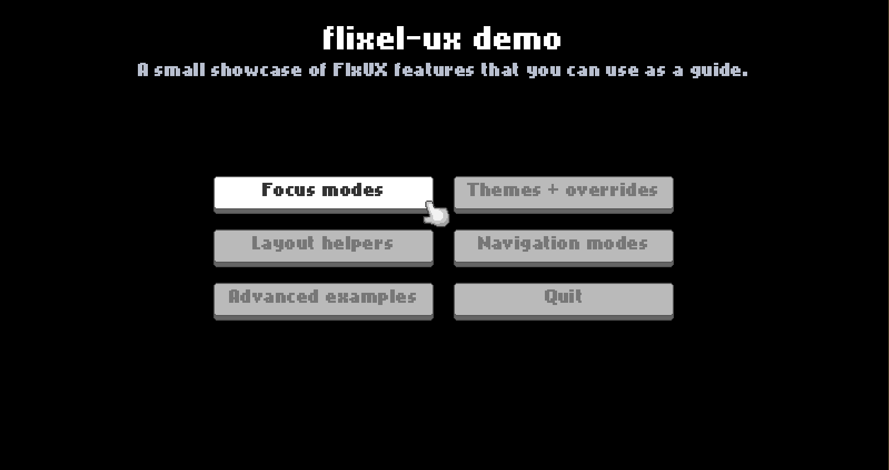

# flixel-ux (FlxUX)

FlxUX is a small UX layer for HaxeFlixel that makes menus and button-based UI work well across mouse, touch, keyboard, and gamepad.

## Demo Project

There’s a runnable HaxeFlixel demo project in `demo/` that showcases focus modes, themes, and layout helpers.

See `demo/README.md` for how to run it and what it covers.

Play the demo in your browser:

- https://axolstudio.github.io/flixel-ux/



## Features

- **Single “menu UX layer” that works across mouse + keyboard + gamepad**
	- Automatically switches between pointer input and navigation input.
- **Navigation + focus management**
	- Keeps track of which button is focused.
	- Navigation styles: LINEAR and SPATIAL.
	- Configurable input capture policy (AUTO/ALWAYS/NEVER).
- **A clean override chain: core → group → button**
	- Set app-wide defaults in `FlxUXCore`.
	- Override per-menu in `FlxUXGroup`.
	- Override per-button in `FlxUXButton`.
- **Skinnable buttons (static or animated)**
	- 9-slice button skins by default.
	- Optional animated skins via sprite sheets + named animation sequences.
- **Themes you can swap at runtime**
	- Load from JSON (`FlxUXTheme.fromJson(...)`) or set up in code.
	- Applying a theme refreshes registered groups and clears cached 9-slice graphics.
- **Layout helpers for common menu patterns**
	- `stack()`, `spread()`, and `grid()`.
	- Last-row alignment options for short grid rows.
	- `matchSize()` for consistent button sizing.
- **Cursor + highlight visuals**
	- Optional mouse cursor sprite.
	- Multiple focus highlight modes (FRAME / NEXT_TO / OVERLAY).

## Installation

Install with haxelib git:

```bash
haxelib git flixel-ux https://github.com/AxolStudio/flixel-ux
```

Then add the library to your project:

`<haxelib name="flixel-ux" />`

## Quick start

Here’s a minimal menu example using `FlxUXGroup`, `addButton()`, and `spread()`.

```haxe
import flixel.FlxState;
import flixel.ux.FlxUXGroup;

class MenuState extends FlxState
{
	override public function create():Void
	{
		super.create();

		var group = new FlxUXGroup();
		add(group);

		group.addButton("Play", startGame);
		group.addButton("Options", openOptions);
		group.addButton("Quit", quit);

		group.spread(8);
		group.alignCenter();
	}

	function startGame():Void {}
	function openOptions():Void {}
	function quit():Void {}
}
```

## Basic usage patterns

### Core System Overview

- `FlxUXCore` is the global manager. It reads input and keeps track of focus.
- `FlxUXGroup` is a container for UI buttons that should participate in navigation.
- `FlxUXButton` is a button that supports FlxUX focus and skins.

### A typical state lifecycle

In most states, you:

1) Create one or more `FlxUXGroup`s
2) `add(group)` them to the state
3) Add buttons with `addButton()` (or `addUXButton()` for existing buttons)
4) Lay them out with `stack()`, `spread()`, `grid()`, then position the group

You usually do not need to call `FlxUXCore.init()` yourself; creating a `FlxUXGroup` auto-initializes FlxUX.

### Vertical menus (stack)

```haxe
var menu = new FlxUXGroup();
add(menu);

menu.addButton("New Game", onNewGame);
menu.addButton("Continue", onContinue);
menu.addButton("Options", onOptions);

menu.stack(6);
menu.alignCenter();
```

### Grid menus

```haxe
import flixel.ux.FlxUXCore.FlxUXGridLastRowAlign;

var grid = new FlxUXGroup();
add(grid);

grid.addButton("A", onA);
grid.addButton("B", onB);
grid.addButton("C", onC);
grid.addButton("D", onD);
grid.addButton("E", onE);

grid.grid(3, 8, 8, FlxUXGridLastRowAlign.CENTER);
grid.alignCenter();
```

### Explicit sizing and matchSize()

Buttons default to `autoSizeToLabel = true`. If you want consistent-sized buttons, you typically do one of these:

```haxe
var g = new FlxUXGroup();
add(g);

g.addButton("Short", onShort);
g.addButton("A much longer label", onLong);

g.matchSize();
g.stack(6);
g.alignCenter();
```

## Navigation

FlxUX supports two navigation styles: **LINEAR** and **SPATIAL**.

You can set the default navigation style globally:

```haxe
FlxUXCore.navStyle = FlxUXNavStyle.LINEAR;

// or
FlxUXCore.navStyle = FlxUXNavStyle.SPATIAL;
```

### LINEAR navigation

LINEAR navigation is essentially a "next / previous" list.

- Pressing **DOWN** or **RIGHT** moves to the next eligible button in the order it was added.
- Pressing **UP** or **LEFT** moves to the previous eligible button.
- When FlxUX reaches the last eligible button in a group, it continues to the next eligible group in the state.
- When it reaches the end of the final eligible group, selection wraps back to the start.

LINEAR is great for simple menus because the behavior is predictable and doesn't depend on button positions.

### SPATIAL navigation

SPATIAL navigation tries to move focus based on where buttons are on screen.

- Pressing a direction searches for the "best" next button in that direction.
- This is typically what you want for grids and irregular layouts.

Because SPATIAL is position-based, your layout matters: if you move buttons around, the navigation results will change.

### What is Navigable in FlxUX?

In **NAV mode** (keyboard/gamepad), FlxUX only considers buttons that are being **updated by Flixel**.

In practice, a button can be focused if:

- Its `FlxUXButton.update()` is getting called this frame, and
- The button is eligible (`exists`, `alive`, `visible`, `active`, and not `locked`), and
- Its `FlxUXGroup` is eligible (`exists`, `alive`, `visible`, `active`, `uxActive = true`, `capturesNav = true`).

This matches how Flixel “modal” UI works: when you open a `subState`, the underlying state typically stops updating, so those hidden buttons automatically become non-navigable.

If you intentionally keep underlying UI updating (for example, by customizing substate behavior), those buttons will remain navigable too — FlxUX simply follows whatever Flixel is updating.

## Styling

FlxUX styling is based on a simple override chain:

1) **`FlxUXCore`** (global defaults for your whole project)
2) **`FlxUXGroup`** (menu-level defaults)
3) **`FlxUXButton`** (per-button overrides)

The easiest way to think about it is: set a good-looking global default in `FlxUXCore`, then override only where you need to.

### Global button skin (applies to every button)

Set a graphic on `FlxUXCore` and every new `FlxUXButton` will use it unless a group or button overrides it.

#### A basic 4-frame button graphic

This is the classic Flixel button layout: a single spritesheet with 4 frames:

1) UP
2) OVER
3) DOWN
4) LOCKED (disabled)

```haxe
// Applies to all FlxUXButtons (unless overridden)
FlxUXCore.buttonGraphic = "assets/images/ui/button_4frame.png";
```

#### A 4-frame 9-slice button graphic

If your buttons are 9-slice skins, you can still use the same 4-frame idea. Each frame is treated as its own 9-slice source.

```haxe
FlxUXCore.buttonGraphic = new FlxUX9Slice(
	"assets/images/ui/button_4frame_9slice.png",
	16,
	16,
	6,
	6,
	6,
	6);
```

Animations are also supported (sprite sheets + named sequences), but for most menus a static 4-frame skin is the simplest starting point.

### Global label styling

```haxe
FlxUXCore.buttonLabelColor = 0xFFFFFFFF;
FlxUXCore.buttonLabelColorLocked = 0xFF777777;
```

### Override per menu (group)

If one menu needs a different look, set the same properties on the `FlxUXGroup`. This overrides the core defaults for buttons in that group.

```haxe
var menu = new FlxUXGroup();
add(menu);

menu.buttonGraphic = "assets/images/ui/pause_button_4frame.png";
menu.buttonLabelColor = 0xFFFFE7B0;
```

### Override a single button

For one-off special cases, set it directly on the button. This overrides both the group and the core.

```haxe
var danger = menu.addButton("Delete Save", onDelete);
danger.buttonGraphic = "assets/images/ui/danger_button_4frame.png";
danger.buttonLabelColor = 0xFFFF4B4B;
```

## Themes

Themes are the “bundle everything” version of the same override chain. Instead of setting lots of individual properties, you can package them into a `FlxUXTheme` and apply it.

### Create a theme in code

```haxe
var myTheme = new FlxUXTheme({
	buttonGraphic: new FlxUX9Slice("assets/images/ui/button_4frame_9slice.png", 16, 16, 6, 6, 6, 6),
	buttonLabelColor: 0xFFFFFFFF,
	buttonLabelColorLocked: 0xFF777777
});

FlxUXCore.theme = myTheme;
```

### Group and button theme overrides

The same override chain still applies:

- `FlxUXCore.theme` sets the default theme
- `group.theme` overrides it for that menu
- `button.theme` overrides it for that one button

```haxe
menu.theme = new FlxUXTheme({ buttonLabelColor: 0xFFFFE7B0 });

var special = menu.addButton("Special", onSpecial);
special.theme = new FlxUXTheme({ buttonLabelColor: 0xFF00E5FF });
```

### Load a theme from JSON

```haxe
var themeJson = Assets.getText("themes/default.json");
FlxUXCore.theme = FlxUXTheme.fromJson(themeJson);
```

You can also pass the JSON string directly to the constructor: `new FlxUXTheme(themeJson)`. `FlxUXTheme.fromObject()` remains available when you prefer the factory-method style. See `FlxUXTheme` for the full list of supported settings.
